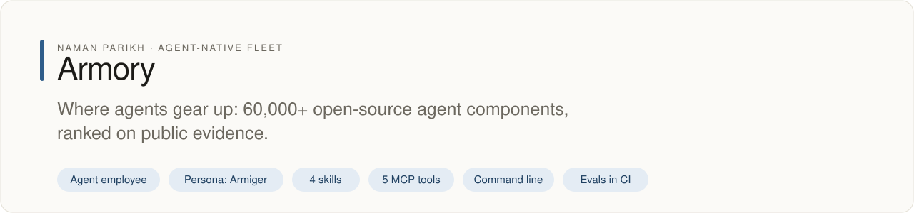

<div align="center">

# ⚔️ Armory

<!-- fleet:header:start -->
<p align="center"><picture><source media="(prefers-color-scheme: dark)" srcset="assets/banner-dark.svg"></picture></p>

<p align="center">
<a href="https://github.com/naman10parikh/armory/actions/workflows/ci.yml"></a>
<a href="https://github.com/naman10parikh/armory/releases"></a>
<a href="LICENSE"></a>
<a href="#use-it-from-any-coding-agent"></a>
<a href="https://x.com/naman10parikh"></a>
<a href="https://www.linkedin.com/in/naman-parikh1/"></a>
</p>

<p align="center"><a href="#quick-start">Quick start</a> · <a href="docs/README.md">How it works</a> · <a href="AGENTS.md">AGENTS.md</a> · <a href="llms.txt">llms.txt</a> · <a href="skills/">Skills</a> · <a href="https://github.com/naman10parikh/armory/discussions">Discussions</a> · <a href="https://github.com/naman10parikh">All projects</a></p>

**Where agents gear up: 60,000+ open-source agent components, ranked on public evidence.**

Armory is an agent employee, a packaged specialist agent with its own skills, memory and tests. It owns one job: MCPs and the component registry. Its persona is Armiger. Coding agents use it through its skills, its MCP server and its command line. A nightly job grows its catalogue, reruns every gate, and commits the result to main only when all of them pass.

_Armory is part of an agent-native play for agent-native systems that can eventually be recursively self-improving and evolving, operated by agent employees._

<p align="center"></p>
<!-- fleet:header:end -->

[**🔗 Live registry → armory-murex.vercel.app**](https://armory-murex.vercel.app) · [Browse 60,000+ components](https://armory-murex.vercel.app/browse) · [Stack](https://armory-murex.vercel.app/stack) · [Components](https://armory-murex.vercel.app/c)

 

**Last updated:** 2026-10-19T14:31:01.637Z (UTC), when `catalog.json` was last generated.

</div>

Armory is the open-source, ever-evolving registry of every agent-harness component: MCP servers, skills, hooks,
sub-agents, identity files, memory patterns, rules, CLIs, eval frameworks, observability, infrastructure, and the
workflows that compose them. It is for coding agents, and the people who run them, who would rather reach for proven
gear than hand-roll it: one armory your agent reaches into to grab exactly what it needs. ***For agents, by agents,
of agents.***

<!-- fleet:use:start -->
## Use it from any coding agent

**Claude Code**: the plugin brings the skills, sub-agents, hooks and MCP server.

```
/plugin marketplace add naman10parikh/armory
/plugin install armory@armory
```

<details><summary>Its MCP server, Codex, Cursor, Gemini CLI, one skill and the command line</summary>

**Its MCP server**, in any MCP client:

```bash
claude mcp add --transport stdio armory -- npx -y -p github:naman10parikh/armory armory-mcp
codex mcp add armory -- npx -y -p github:naman10parikh/armory armory-mcp
```

Cursor (`.cursor/mcp.json`), Gemini CLI (`.gemini/settings.json`) and most other clients take the same command as JSON:

```json
{
  "mcpServers": {
    "armory": {
      "command": "npx",
      "args": [
        "-y",
        "-p",
        "github:naman10parikh/armory",
        "armory-mcp"
      ]
    }
  }
}
```

**Gemini CLI**: the extension brings the context and the MCP server.

```bash
gemini extensions install https://github.com/naman10parikh/armory
```

**One skill** (4 in all, in [skills/](skills/)), in any agent that reads Agent Skills:

```bash
gemini skills install https://github.com/naman10parikh/armory --path armory-skill
git clone --depth 1 https://github.com/naman10parikh/armory /tmp/armory && cp -r /tmp/armory/armory-skill ~/.claude/skills/
```

**The command line:**

```bash
npx -y -p github:naman10parikh/armory armory --help
```

</details>

Codex, Cursor, OpenCode, GitHub Copilot and other agents read [AGENTS.md](AGENTS.md); Claude Code reads [CLAUDE.md](CLAUDE.md) and Gemini CLI reads [GEMINI.md](GEMINI.md), which import it. [llms.txt](llms.txt) maps every surface for agents that read first.
<!-- fleet:use:end -->

## Quick start

These commands were run for this README. The npm packages start fastest; the GitHub form above builds this
repository's latest code on first use, which took 90 seconds when this was written. npm 11.6.1 and 11.6.2 can stop
that first build with "Lock compromised", an npm bug fixed in 11.6.3: run `npm i -g npm@latest` first.

```bash
npx -y @namanparikh/armory search "browser automation"      # rank across 60,000+ components
npx -y @namanparikh/armory install github-mcp --dry-run     # see what it would write
npx -y @namanparikh/armory install github-mcp               # wire GitHub's own MCP server into this project
npx -y @namanparikh/armory init --claude                    # add the Armory MCP server (--cursor|--codex|--opencode|--gemini)
```

Install it once with `npm i -g @namanparikh/armory`; the command is `armory`. The MCP server alone is
`npx -y armory-mcp`. The newest commands (`sandbox-run`, `memory-search`, `runs`) are on GitHub ahead of the next npm
release: `npx -y -p github:naman10parikh/armory armory --help`.

## How it works

### The repository, in five zones

```
🧰 COMPONENT TYPES: every harness component is its own root folder
   mcps/ (~21,850)  skills/ (~900)  subagents/ (~991)  workflows/ (~716)
   claudemd-rules/  hooks/  clis-tools/  evals/  observability/
   infrastructure/  memory/  identity/
   └─ each <type>/ holds installable files; full metadata → brain/components/<type>/

📚 brain/           The catalog's source of truth (Obsidian vault): a detail page per component
catalog.json        └─ generated index (never hand-edited; counts grow nightly)

🔧 ARMORY'S OWN HARNESS: install Armory itself
   armory-mcp/  armory-skill/  cli/  skills/armory-*  .claude/agents/armory-*
   .claude-plugin/  .codex-plugin/  .hermes-plugin/  .cursor/  .codex/
   .opencode/  .gemini/  opencode.json  .mcp.json  install.sh  install.ps1

⚙️ THE MACHINERY: grow and self-improve
   ingest/ (crawlers, promote, catalog, validate, test-gate, surface)
   incoming/ (ephemeral staging)  repos/ (source-repo watchlist)  autolab.yml  dsip.json

🌐 SITE + DOCS
   web/ (the registry website → armory-murex.vercel.app)  docs/  scripts/ (dev helpers)
```

> **Where are the MCPs?** `mcps/<slug>.json` holds install configs; details are in `brain/components/mcps/<slug>.md`.
> The full map of every folder is [STRUCTURE.md](./STRUCTURE.md).

### The most of everything, in one place

Armory mirrors and de-duplicates the biggest open-source catalogs into one connected brain, so it holds more harness
components than any single registry:

| Category | What it holds |
|---|---|
| **MCPs** | PulseMCP, Smithery, Glama, mcp.so, awesome-mcp-servers and the official `modelcontextprotocol/servers`, deduped into ~61,700 (26 September 2026) |
| **Skills** | `anthropics/skills`, `obra/superpowers`, community skill packs, awesome-claude-code |
| **Sub-Agents** | wshobson, VoltAgent, davila7 and community collections |
| **Rules** | awesome-cursorrules, multi-language rule packs, CLAUDE.md collections |
| **Hooks** | disler hooks-mastery, decider, awesome-claude-code and community hook sets |
| **CLIs & Tools · Evals · Observability · Infrastructure** | the four categories every other list under-covers, first-class here |
| **Identity · Memory · Workflows** | SOUL and persona specs, memory layers, command and composition recipes |

Every entry is de-duplicated by name, carries provenance (`source_repo`, `license`, `stars`, `verified_at`), and is
wired into a knowledge graph through `related:` links, so following one component leads you to the next.

### Not an aggregator for humans: a brain for agents

Curated lists get starred and forgotten in a browser tab. Armory is built to be used by the agents themselves:

- 🤖 **Agents read it.** Your coding agent pulls the right component straight into its harness.
- 🔎 **Agents query it.** The Armory MCP server, the `armory` CLI and the search site all read one generated
  `catalog.json`.
- 🛠️ **Agents install from it.** `armory install <name>` fetches the real thing (through `gh` or git) and drops it
  into whatever harness you are in.
- ♻️ **Agents improve it.** It restocks itself nightly ([`autolab.yml`](./.github/workflows/autolab.yml), a remote
  cron, no laptop needed). `claude -p` discovers new sources (Darwin [DSIP](./dsip.json) Performance-Novelty
  selection); every candidate passes the [Hamel test-gate](./ingest/test-gate.mjs), functional and behavioral, before
  it enters, so skills cannot drift or go stale. Then dedup, validate, commit.

### A package manager for harnesses

`armory install` detects your harness (`.claude/`, `.cursor/`, `.codex/`, `.opencode/`, `.gemini/`), fetches the
component from its source repository, and installs it the right way for that CLI: MCP servers into the MCP config,
skills into the skills folder, sub-agents, hooks, rules and commands into their slots. One command, any harness, any
component type. Target another harness with `--cli cursor` (or `codex`, `opencode`, `gemini`).

Before you install a stranger's code, `armory sandbox-run <name>` clones it inside an isolated E2B sandbox and reports
its manifests, install-time scripts and tests (it needs `E2B_API_KEY`). `armory runs` shows every install, submit and
sandbox run, and `armory memory-search` searches Armory's own notes.

### Install Armory in other harnesses

Install it once and your agent can search and pull from all 60,000+ components (61,739 on 28 September 2026), with the
~3,170 vendored skills, sub-agents, workflows, hooks and rules right there.

| Harness | Install |
|---|---|
| **Codex** | `codex plugin marketplace add naman10parikh/armory` |
| **OpenCode** | add `armory-mcp` to `opencode.json`, see [PLUGIN.md](./PLUGIN.md) |
| **Hermes** | `hermes plugin add naman10parikh/armory` |
| **Anything** | `npx @namanparikh/armory init` (detects the harness; `--claude` `--cursor` `--codex` `--opencode` `--gemini` to pick) or `bash install.sh` |

The plugin wires in the Armory MCP server (`armory-mcp`: live search at runtime; installing is CLI-only) and the
`armory` skill. Full per-harness commands are in [PLUGIN.md](./PLUGIN.md); Armory's own harness against the catalog
is explained in [HARNESS.md](./HARNESS.md).

### The actual gear lives here, not just links

The catalog is not only metadata. The real component files are vendored in:

- `skills/ subagents/ workflows/ hooks/ claudemd-rules/`: ~3,170 actual files at the repository root (content
  verbatim, with a provenance header).
- Harness-native drops: `.claude/{skills,agents,commands,hooks}` and `.cursor/rules/`, ready to use as they are.
- `brain/` stays the metadata knowledge graph (the source of truth). MCP details live in
  `brain/components/mcps/<slug>.md`. MCP servers are cataloged as install specs in `catalog.json`; the servers
  themselves run elsewhere.

### Open it as a brain

`brain/` is an Obsidian vault: Markdown, frontmatter and `[[wikilinks]]`. Open the folder in Obsidian and explore the
whole graph; the `related:` edges are the connections between gear. One source of truth generates the site, the MCP
server and the CLI (counts are computed, never hand-typed).

### Add a component

Armory is a registry: add a component through a pull request or `armory submit`. [CONTRIBUTING.md](./CONTRIBUTING.md)
has the one-file format, and [CODE_OF_CONDUCT.md](./CODE_OF_CONDUCT.md) the ground rules. Every contribution restocks
the armory for every agent.

### Standing on the shoulders of

Armory is for agents, by agents, of agents: agent-native and recursively self-improving, built almost entirely by
agents. None of it would exist without the open-source catalogs, collections and reference repositories it mirrors,
de-duplicates and learns from. The self-improving loop [keeps tabs on them](./repos/README.md) so their newest work
keeps flowing in; the live list with freshness is [`repos/watchlist.json`](./repos/watchlist.json).

- **Navigation and awesome-lists:** [hesreallyhim/awesome-claude-code](https://github.com/hesreallyhim/awesome-claude-code), [VoltAgent/awesome-claude-code-subagents](https://github.com/VoltAgent/awesome-claude-code-subagents), [PatrickJS/awesome-cursorrules](https://github.com/PatrickJS/awesome-cursorrules), [vijaythecoder/awesome-claude-agents](https://github.com/vijaythecoder/awesome-claude-agents)
- **Mega-collections:** [davila7/claude-code-templates](https://github.com/davila7/claude-code-templates), [affaan-m/ecc](https://github.com/affaan-m/ecc) (**ECC**), [wshobson/agents](https://github.com/wshobson/agents) and [wshobson/commands](https://github.com/wshobson/commands), [dl-ezo/claude-code-sub-agents](https://github.com/dl-ezo/claude-code-sub-agents)
- **Anthropic official:** [anthropics/skills](https://github.com/anthropics/skills), [anthropics/anthropic-cookbook](https://github.com/anthropics/anthropic-cookbook), [anthropics/anthropic-quickstarts](https://github.com/anthropics/anthropic-quickstarts), [modelcontextprotocol/servers](https://github.com/modelcontextprotocol/servers)
- **Hooks and skills:** [disler/claude-code-hooks-mastery](https://github.com/disler/claude-code-hooks-mastery), [decider/claude-hooks](https://github.com/decider/claude-hooks), [obra/superpowers](https://github.com/obra/superpowers)
- **MCP registries:** [PulseMCP](https://www.pulsemcp.com), [Smithery](https://smithery.ai) ([smithery-ai/registry](https://github.com/smithery-ai/registry)), [Glama](https://glama.ai/mcp), [mcp.so](https://mcp.so)
- **Protocol:** [google/A2A](https://github.com/google/A2A)

Every cataloged entry carries its `source_repo` and `license` provenance back to one of these. Thank you. 🙏

<!-- fleet:anatomy:start -->
## What it is made of

Every project in this fleet is graded on the same 11 harness components and on self-improvement. Each mark is backed by a file you can open.

| Component | Grade | Where |
| --- | --- | --- |
| Identity | ✅ | SOUL.md:8 |
| Memory | ✅ | cli/src/memory.ts:1 |
| Skills | ✅ | skills/armory-vet-component/SKILL.md:1 |
| Tools/CLIs | ✅ | cli/package.json:7 |
| Hooks | ✅ | .claude/settings.json:4 |
| Sub-agents | ✅ | .claude/agents/armory-curator.md:1 |
| MCPs | ✅ | armory-mcp/src/index.ts:45 |
| Dispatch | ✅ | .github/workflows/autolab.yml:17 |
| Evals | ✅ | .github/workflows/ci.yml:29 |
| Observability | ✅ | cli/src/runlog.ts:1 |
| Sandbox/Infra | 🟡 | cli/src/sandbox.ts:63 (live boot needs the founder's E2B key) |
| Self-improvement | ✅ | dsip.json:1 |

✅ real and tested · 🟡 partial, with the reason in the row · ❌ absent
<!-- fleet:anatomy:end -->

<!-- fleet:footer:start -->
## How it improves itself

It carries its own evals and a self-improvement contract, [`dsip.json`](dsip.json), which says what it may change and how a change is judged. A nightly job grows its catalogue, reruns every gate, and commits the result to main only when all of them pass. Lessons it learns are kept as rules in its memory files.

## Part of a fleet

One of the projects by [Naman Parikh](https://github.com/naman10parikh). Each owns one part of an agent's harness, or of the product around an agent, and all of them follow one standard.

| Related project | What it owns |
| --- | --- |
| [AgentDial](https://github.com/naman10parikh/agentdial) | Identity |
| [WikiMem](https://github.com/naman10parikh/wikimem) | Memory |
| [Skillsmith](https://github.com/naman10parikh/skillsmith) | Skills |
| [Agent Booster](https://github.com/naman10parikh/agent-booster) | Tools / CLIs |
| [AgentGrid](https://github.com/naman10parikh/agentgrid) | Dispatch |
| [AgentSwarm](https://github.com/naman10parikh/agentswarm) | Dispatch |
| [AgentBench](https://github.com/naman10parikh/agentbench) | Evals |
| [AgentMoney](https://github.com/naman10parikh/agentmoney) | Observability |
| [Claude Harness](https://github.com/naman10parikh/claude-harness) | The whole harness, as a template |

## Community

Questions and ideas go to [Discussions](https://github.com/naman10parikh/armory/discussions); bugs go to [issues](https://github.com/naman10parikh/armory/issues/new/choose). Follow the work on [X](https://x.com/naman10parikh) and [LinkedIn](https://www.linkedin.com/in/naman-parikh1/).

## Contributing and security

Read [CONTRIBUTING.md](CONTRIBUTING.md). AI-assisted pull requests are welcome. Report a vulnerability privately, as [SECURITY.md](SECURITY.md) explains.

## License

MIT, © 2026 Naman Parikh. See [LICENSE](LICENSE) and [NOTICE](NOTICE).

## Star history

If it is useful to you, a star helps other people find it.

<a href="https://star-history.com/#naman10parikh/armory&Date"><picture><source media="(prefers-color-scheme: dark)" srcset="https://api.star-history.com/svg?repos=naman10parikh/armory&type=Date&theme=dark"></picture></a>

## Contributors

<a href="https://github.com/naman10parikh/armory/graphs/contributors"></a>
<!-- fleet:footer:end -->
