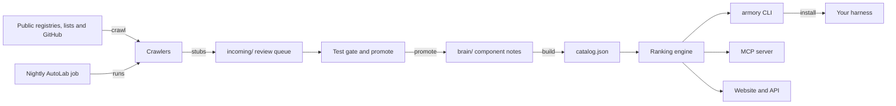

# How Armory works

Armory is a ranked catalog of open-source parts for coding agents: MCP servers, skills, sub-agents, rules, hooks, CLIs and more.
These parts make up a harness, the set of tools, skills, hooks and rules around a model.
Armory gives every ranked part one 0 to 100 score built from public evidence, and it installs a part into your harness.
It is for people and coding agents choosing gear for an agent.
You reach it through a command-line tool, an MCP server and a website.

## The parts

Every catalog entry is one Markdown note with YAML front matter under `brain/components/<type>/`, sorted into 12 types.
[ingest/catalog.mjs](../ingest/catalog.mjs) walks those notes and writes [catalog.json](../catalog.json), the generated index with its counts.
[ingest/validate.mjs](../ingest/validate.mjs) checks the required fields: `name`, `type`, `description`, `source_url`, `license` and `verified_at`.
[STRUCTURE.md](../STRUCTURE.md) maps every root folder, including the 12 type folders of installable files.

[lib/rank.mjs](../lib/rank.mjs) is the ranking engine.
It turns each signal into a percentile within its own kind, such as one repository's stars against other repositories' stars.
A row's Universal score is 0.8 times its strongest percentile plus 0.2 times its second strongest.
A row with no real signal stays unranked.
The same engine serves the CLI in [cli/](../cli/), the MCP server in [armory-mcp/](../armory-mcp/) and the website in [web/](../web/).
MCP, the Model Context Protocol, is the standard way an agent calls outside tools.

The catalog grows through the crawlers in [ingest/](../ingest/).
Each `crawl-*.mjs` file turns one source into stub notes under `incoming/<source>/`, a review queue that git does not track.
[ingest/test-gate.mjs](../ingest/test-gate.mjs) grades each stub.
Level 1 checks the schema, and level 2 checks that the entry is usable: a real description, source link, body and tags.
[ingest/promote.mjs](../ingest/promote.mjs) removes duplicates and moves passing stubs into `brain/components/`.

## What happens when you run it

The main flow is `armory search <terms>`, then `armory install <name>`.

1. [cli/src/index.ts](../cli/src/index.ts) parses the command. `search` scores each query term: 3 for a name match, 2 for a tag and 1 for the description. Ties go to the higher Universal score.
2. `loadCatalog` in [cli/src/catalog.ts](../cli/src/catalog.ts) reads `catalog.json` from the clone, or the copy packed into an installed package.
3. `install` calls `resolveComponent` in [cli/src/install.ts](../cli/src/install.ts), which finds the part by exact name or by a fuzzy match.
4. [cli/src/targets.ts](../cli/src/targets.ts) picks the harness from `--cli`, or detects it from the project folder. The targets are Claude Code, Cursor, Codex, OpenCode and Gemini CLI.
5. For an MCP server, it adds an entry to that harness's MCP config. It does so only when the start command downloads a package that npm or PyPI ties to the part's own repository.
6. For skills, sub-agents, rules, workflows and hooks, it fetches the files from GitHub with `gh` or `curl`. It writes them into the harness's folder for that type.
7. Other types, such as CLIs and infrastructure, install with their own tool, so Armory places nothing and says so.
8. `--dry-run` prints the plan and writes nothing, and `--force` replaces existing files or MCP entries.
9. [cli/src/runlog.ts](../cli/src/runlog.ts) appends the run to the audit trail, which `armory runs` prints. The exit code is 1 when nothing was placed.

## Extending it

- **A new part.** Add a note to `brain/components/<type>/` that follows [CONTRIBUTING.md](../CONTRIBUTING.md). Or run `armory submit --file <path>`, which checks it and stages it in `incoming/`. Then run `pnpm catalog`, `pnpm validate` and `pnpm eval`.
- **A new source.** Add an `ingest/crawl-<source>.mjs` file. Follow the adapter shape in [ingest/crawl.mjs](../ingest/crawl.mjs): a name, a type, `fetch()` and `toComponent(item)`. Adapters take injected data, so they unit-test without the network.
- **A new install target.** Add its name to `CLIS` and its folders to `LAYOUTS` in [cli/src/targets.ts](../cli/src/targets.ts).
- **A new ranking signal.** Add the field to `FIELDS` in [ingest/catalog.mjs](../ingest/catalog.mjs) and in [scripts/persist-signals-to-brain.mjs](../scripts/persist-signals-to-brain.mjs), and to the notes' front matter. Miss one, and the next rebuild drops the signal. Then use it in [lib/rank.mjs](../lib/rank.mjs).
- **A new MCP tool.** Register it with `server.registerTool` in [armory-mcp/src/index.ts](../armory-mcp/src/index.ts), and test it in [armory-mcp/test/server.test.ts](../armory-mcp/test/server.test.ts).
- **A new CLI command.** Add a `program.command` block to [cli/src/index.ts](../cli/src/index.ts), with a test in [cli/test/](../cli/test/).

## Questions

**Does it need an API key or cost money?**
Armory is free and MIT licensed.
Search, rank, get, list, install and the MCP server call no model and need no key.
`armory sandbox-run` needs `E2B_API_KEY` and the optional `e2b` package, and E2B is a paid service.
The website's ask box can use a `GEMINI_API_KEY` to read a question, and it falls back to keyword search without one.
The nightly job has an optional discovery step that runs `claude -p` with an Anthropic key, and its other steps need no model.

**Does any data leave the machine?**
Search, rank and get read the local catalog.
`install` downloads files from GitHub and asks npm or PyPI where a package comes from.
`sandbox-run` clones the part's repository inside an E2B sandbox, so nothing from it runs on your machine.
`submit` writes into the local `incoming/` folder.
The run log stays in `logs/runs.jsonl` in a clone, or in `~/.armory/runs.jsonl` for an installed copy.

**How does it improve itself?**
[dsip.json](../dsip.json) names no level.
Its loop steps are discover, score, crawl, test-gate, promote, catalog, validate, ship and archive.
Every night [.github/workflows/autolab.yml](../.github/workflows/autolab.yml) crawls Smithery, Glama and mcp.so, then gates and promotes the new stubs.
It rebuilds the catalog, refreshes GitHub stars and folds repositories that were renamed or listed twice.
Then validate, the test gate and [scripts/lint-catalog.mjs](../scripts/lint-catalog.mjs) run as a hard gate.
If anything changed, it commits to main and appends a line to [AUTOLAB-LOG.md](../AUTOLAB-LOG.md).
[.github/workflows/crawl-feed.yml](../.github/workflows/crawl-feed.yml) is the manual variant, which opens a pull request for a person to review.

**How do I run its tests or evals?**
`pnpm test` runs the tests in [ingest/](../ingest/) and [scripts/lint-catalog.test.mjs](../scripts/lint-catalog.test.mjs) with the test runner built into Node.
`pnpm eval` runs the validator, the test gate and the catalog lint over the whole catalog.
The CLI, the MCP server and the website keep their own tests in [cli/test/](../cli/test/), [armory-mcp/test/](../armory-mcp/test/) and [web/test/](../web/test/).
Inside `cli/` or `armory-mcp/`, `npm test` runs that package's Vitest suite.
[.github/workflows/ci.yml](../.github/workflows/ci.yml) runs on every push and pull request.
It also drives the built CLI as a user would and installs the packed packages into an empty folder.

**What does it not do?**
It does not host or run the parts it lists. Each entry points at its source.
A score is not a review. It comes from public evidence such as stars, forks, installs, practitioner mentions and hands-on trials.
`install` places files only for MCP servers, skills, sub-agents, rules, workflows and hooks.

## More

- [architecture.md](architecture.md): the one-vault model and the ingest pipeline, from an earlier stage of the project.
- [DATA-SCHEMA.md](DATA-SCHEMA.md): every field `catalog.json` stores.
- [FORMULA-AUDIT.md](FORMULA-AUDIT.md): an audit of whether one score can rank every kind of part.
- [CATALOG-SIZE.md](CATALOG-SIZE.md): why the catalog is also written gzipped.
- [CHANNELS.md](CHANNELS.md): the web, email and SMS channels that answer questions.
- [CONTRIBUTORS.md](CONTRIBUTORS.md): how outside projects report the tools practitioners use.
- [SHELF-FIT-PROPOSAL.md](SHELF-FIT-PROPOSAL.md): how parts are placed on the shelves of the stack page.
- [parallel-dev.md](parallel-dev.md): running several coding agents at once with git worktrees.
- [surface-transcripts/](surface-transcripts/): recorded sessions of the CLI and the MCP server.
- [ui-2026-09-26/REPORT.md](ui-2026-09-26/REPORT.md) and [ui-audit-2026-09-25/](ui-audit-2026-09-25/): website checks with screenshots.
